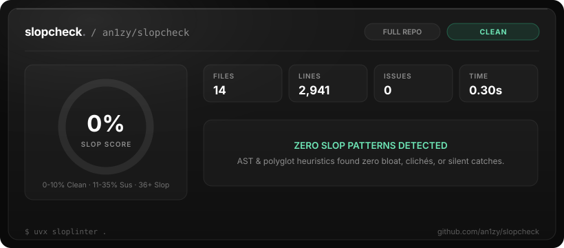
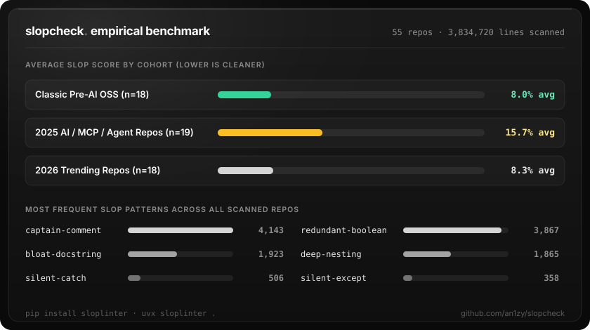

<div align="center">

# slopcheck.
### *Fast AST &amp; Polyglot Linter, Semantic PR Gate, and GitHub Action for Code Slop*

[](https://github.com/an1zy/slopcheck/actions/workflows/ci.yml)
[](https://pypi.org/project/sloplinter/)
[](https://www.python.org/downloads/)
[](skills/slopcheck/SKILL.md)
[](assets/scorecard-clean.svg)
[](LICENSE)

**English** · [Русский](README.ru.md)

<br/>


</div>

---

Fast static linter targeting code bloat and shortcuts typical of unreviewed LLM edits: empty `except: pass` / `catch (e) {}`, `TODO: implement` placeholders, bloated docstrings, copy-pasted duplicate helpers across files, tests without assertions, and shortcuts like `verify=False` or `shell=True`.

Runs Python AST + tokenizer passes alongside a zero-dependency polyglot scanner for **JS/TS, Rust, C/C++, C#, Go, and Java**, returning a `0–100%` Slop Score locally or in CI.

## Quick Start

```bash
pip install sloplinter
# or run without installing:
uvx sloplinter .
```

Install as an Agent Skill:

```bash
npx skills add an1zy/slopcheck
```

## CLI Usage

```bash
# Scan a directory or file
slopcheck .

# Scan only uncommitted changes or PR branch diff
slopcheck . --diff
slopcheck . --base origin/main --max-score 10
slopcheck . --staged

# Gate CI on threshold
slopcheck . --max-score 20

# Export monochrome SVG scorecard or JSON
slopcheck . --svg assets/scorecard.svg --title "owner/repo"
slopcheck . --json
slopcheck . --badge
slopcheck . --summary --exclude vendor --exclude migrations
```

<details>
<summary>Preview SVG scorecard (--svg)</summary>

<p align="center">
  
</p>

</details>

## GitHub Action (`an1zy/slopcheck@v1`)

Drop into `.github/workflows/slopcheck.yml` to scan only newly added/modified lines on PRs and post a sticky report:

```yaml
name: Slopcheck

on:
  pull_request:

permissions:
  contents: read
  pull-requests: write

jobs:
  slopcheck:
    runs-on: ubuntu-latest
    steps:
      - uses: actions/checkout@v4
      - uses: an1zy/slopcheck@v1
        with:
          max-score: 20
          diff-only: true
          comment-pr: true
```

<details>
<summary>Action inputs &amp; outputs</summary>

| Input | Default | Description |
| :--- | :---: | :--- |
| `path` | `.` | Directory or file to scan |
| `max-score` | `20` | Maximum allowed Slop Score (0–100) |
| `diff-only` | `false` | Scan only lines modified against `base_ref` on PRs |
| `comment-pr` | `true` | Create or update a sticky Slop Score comment on PRs |
| `fail-on-exceed` | `true` | Fail the step when score exceeds `max-score` |
| `exclude` | `""` | Comma-separated directory or prefix exclusions |
| `svg-path` | `""` | Optional output path for an SVG scorecard |

Outputs: `score`, `verdict`, `badge-url`, `issues-count`.

</details>

## Empirical Benchmark (55 Repos · 3.83M Lines)

Scanned **55 public repos** (`18,138` files, `3,834,720` lines, `13,333` findings) across three cohorts:

<p align="center">
  
</p>

| Cohort | Repos | Mean Score | Median | Clean (`<=10%`) | Notes |
| :--- | :---: | :---: | :---: | :---: | :--- |
| **Classic Pre-AI OSS** (`flask`, `ripgrep`, `serde`, `express`, `hono`, ...) | 18 | **8.0%** | 8.5% | 66.7% | Zero repos above 15% |
| **2025 AI / MCP / Agent Boom** | 19 | **15.7%** | 12.0% | 47.4% | ~2x higher mean; 86.9% of all `emoji-slop` hits |
| **2026 Trending Repos** | 18 | **8.3%** | 7.0% | 72.2% | Rust/TS CLI heavy (`claw-code` 2%, `rtk` 2%, `agent-browser` 3%) |

**Rust** (`3.4%` avg across 8 repos) and **TypeScript** (`5.5%` avg across 11 repos) scored cleaner than **Python** (`14.7%` avg across 32 repos). Tightly engineered AI repos (`anthropics/claude-code` `1%`, `ChromeDevTools/chrome-devtools-mcp` `4%`) stay `CLEAN`, while rushed community skill/wrapper repos spike to `23%–59%`.

## Rules

Thresholds: `0–10%` `CLEAN` · `11–35%` `SUSPICIOUS` · `36–65%` `VIBE-CODED` · `66–100%` `PURE SLOP`.

| Rule | Weight | Languages | What it catches |
| :--- | :---: | :--- | :--- |
| `security-slop` | 15 | Python, JS/TS | `verify=False`, dynamic `shell=True`, `eval`/`exec`, CORS `*`+creds, hardcoded tokens |
| `silent-except` | 15 | Python | Catch handler containing only `pass`, `...`, or lone `print` |
| `silent-catch` | 15 | JS/TS, Rust, C/C++, C#, Go, Java | Empty or suppressed catch blocks |
| `ai-cliche` | 12 | All supported | Markers like `TODO: implement`, `placeholder`, `for brevity` |
| `duplicate-helper` | 12 | Python | Cross-file normalized AST clone reimplementing an existing helper |
| `test-theatre` | 12 | Python, JS/TS | Tests without assertions or constant tautologies (`assert True`, `expect(true).toBe(true)`) |
| `emoji-slop` | 10 | All supported | Decorative emojis in comments and log/print statements |
| `deep-nesting` | 10 | Python | Nesting depth >= 4 (ignoring `elif`) |
| `debug-print` | 8 | All supported | Debug `print`/`console.log` prefixes (`debug`, `here`, `test`, `asdf`) |
| `wildcard-import` | 8 | Python | `from ... import *` imports |
| `bloat-docstring` | 8 | Python | Unstructured docstrings larger than the function body |
| `useless-wrapper` | 7 | Python | Thin wrappers forwarding exact arguments without modification |
| `captain-comment` | 6 | All supported | Short comments echoing the next line |
| `redundant-boolean` | 6 | Python | Comparisons with `True`/`False` or `if/else` returning boolean literals |

## License

MIT © 2026 [an1zy](https://github.com/an1zy)
