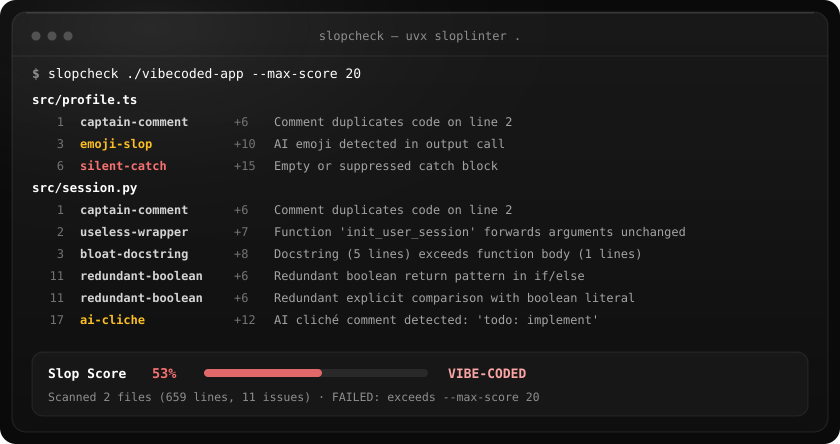
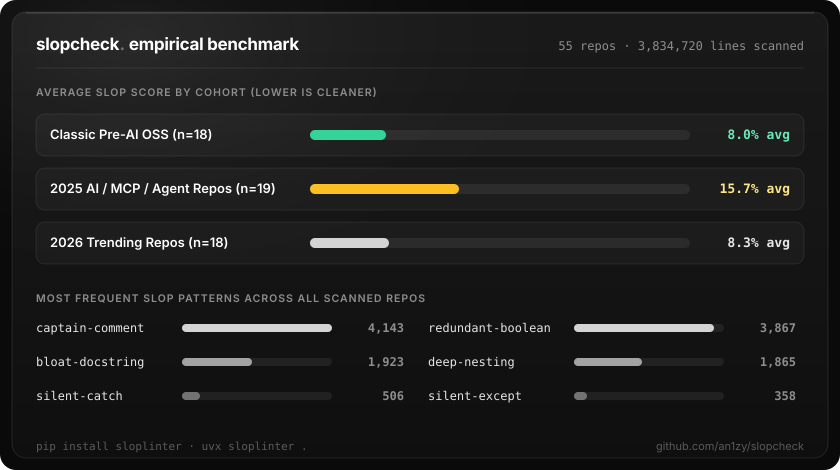

<div align="center">

# slopcheck

**Быстрый CLI-линтер, GitHub Action и Agent Skill для поиска ИИ-слопа в коде и контроля качества в CI.**

[](https://github.com/an1zy/slopcheck/actions/workflows/ci.yml)
[](https://pypi.org/project/sloplinter/)
[](https://www.python.org/downloads/)
[](skills/slopcheck/SKILL.md)
[](assets/scorecard-clean.svg)
[](LICENSE)

[English](README.md) · **Русский**

<br/>



</div>

---

## Зачем нужен slopcheck?

ИИ-агенты генерируют код быстро, но без ревью часто оставляют характерный мусор: пустые блоки `except Exception: pass` / `catch (e) {}`, заглушки `TODO: implement`, огромные докстринги длиннее однострочной функции, декоративные эмодзи в логах и комментариях, а также тавтологичные комментарии вида `# initialize database` прямо над `init_database()`.

`slopcheck` сочетает глубокий AST-анализ и токенизацию для **Python** с быстрым полиглот-сканером для **JS/TS, Rust, C/C++, C#, Go и Java**, рассчитывая итоговый **Slop Score (0–100%)** за доли секунды.

---

## Быстрый старт

Установка через pip:

```bash
pip install sloplinter
```

Запуск без установки через `uvx`:

```bash
uvx sloplinter .
```

Установка как **Agent Skill** (чтобы Claude Code, Cursor или Codex сами проверяли свой diff перед завершением задачи):

```bash
npx skills add an1zy/slopcheck
```

---

## Примеры CLI

```bash
# Полный скан репозитория или файла
slopcheck .

# Проверка только изменённых строк (рабочий diff, ветка или staged)
slopcheck . --diff
slopcheck . --base origin/main --max-score 10
slopcheck . --staged

# Гейт для CI (код возврата 1 при превышении порога)
slopcheck . --max-score 20

# Генерация тёмно-неоновой SVG-карточки или JSON-отчёта
slopcheck . --svg assets/scorecard.svg --title "owner/repo"
slopcheck . --json

# Бейдж shields.io или краткая сводка
slopcheck . --badge
slopcheck . --summary --exclude vendor --exclude migrations
```

---

## GitHub Action (проверка PR + комментарий)

Добавьте `.github/workflows/slopcheck.yml` — Action проверит только изменённые в PR строки и оставит отчёт со Slop Score прямо в Pull Request:

```yaml
name: Slopcheck

on:
  pull_request:

permissions:
  contents: read
  pull-requests: write

jobs:
  slopcheck:
    runs-on: ubuntu-latest
    steps:
      - uses: actions/checkout@v4
      - uses: an1zy/slopcheck@v1
        with:
          max-score: 20
          diff-only: true
          comment-pr: true
```

---

## Эмпирический бенчмарк (55 репозиториев · 3.83M строк)

Мы прогнали `slopcheck` по **55 популярным открытым репозиториям** (`18,138` файлов, `3,834,720` строк кода, `13,333` срабатывания) по трём когортам:

<p align="center">
  
</p>

| Когорта | Репозиториев | Средний балл | Медиана | Чистых (`<=10%`) | Наблюдение |
| :--- | :---: | :---: | :---: | :---: | :--- |
| **Классический OSS до ИИ-бума** | 18 | **8.0%** | 8.5% | 66.7% | Ни одного репо выше 15% |
| **Бум AI / MCP / агентов 2025** | 19 | **15.7%** | 12.0% | 47.4% | Почти **в 2 раза выше**; 86.9% всех `emoji-slop` |
| **Трендовые репо 2026** | 18 | **8.3%** | 7.0% | 72.2% | Мощный сдвиг в сторону Rust/TS CLI (`claw-code` 2%, `rtk` 2%) |

---

## Пороги и правила

- `0–10%`: `CLEAN`
- `11–35%`: `SUSPICIOUS`
- `36–65%`: `VIBE-CODED`
- `66–100%`: `PURE SLOP`

| Правило | Вес | Языки | Что ловит |
| :--- | :---: | :--- | :--- |
| `silent-except` | 15 | Python | Обработчик исключений с `pass`, `...` или одиночным `print` |
| `silent-catch` | 15 | JS/TS, Rust, C/C++, C#, Go, Java | Пустые блоки `catch` |
| `ai-cliche` | 12 | Все | Маркеры вроде `TODO: implement`, `placeholder`, `in a real-world`, `for brevity` |
| `emoji-slop` | 10 | Все | Декоративные эмодзи в комментариях и логах |
| `deep-nesting` | 10 | Python | Вложенность конструкций >= 4 (игнорируя `elif`) |
| `debug-print` | 8 | Все | Отладочный вывод (`debug`, `here`, `test`, `asdf` и др.) |
| `wildcard-import` | 8 | Python | `from ... import *` |
| `bloat-docstring` | 8 | Python | Докстринг длиннее тела функции (кроме Sphinx/doctest) |
| `useless-wrapper` | 7 | Python | Пустые функции-обёртки, просто пробрасывающие аргументы |
| `captain-comment` | 6 | Все | Короткие комментарии, повторяющие код строкой ниже |
| `redundant-boolean` | 6 | Python | Лишние `== True` / `if ...: return True else: return False` |

---

## Лицензия

MIT © 2026 [an1zy](https://github.com/an1zy)
